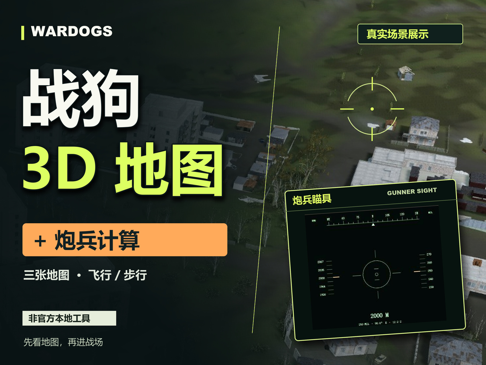

# WARDOGS 战狗 · 本地战术地图 V3.0

参考 MetaForge WARDOGS 地图工具制作的非官方个人本地网页。三图真实地点、地形与模型、游戏炮兵计算、战术绘图和本地小队共享均可交互使用，中文操作，地点名称保留游戏原文。

这是地图核心工具的本地实现，不是 MetaForge 官方客户端，也不冒充原站账号、云服务或游戏本体。日常浏览使用本地资源，不访问远程 CDN。

## 下载完整网站

前往 [GitHub Releases](https://github.com/xinshuowl/wardogs-local-map/releases/latest)，下载 `wardogs-local-map-v3.0.0.zip`，完整解压后双击 `启动地图.cmd`。推荐先安装 Node.js 20.11 或更新版本，以使用完整的小队共享功能。

完整包包含三张地图的运行资源、模型、地形、材质、网站源码，以及宣传视频和封面。Git 仓库保留源码、基础底图、制作素材与验证脚本；大型模型、地形和瓦片通过 Release 完整包分发。GitHub 的 `Source code (zip)` 和 `git clone` 本身不包含这些大型资源。开发者可将完整包内的 `assets` 目录复制到克隆目录，保留相同的目录结构。

Release 另提供宣传片 MP4 和 `SHA256SUMS.txt`。可用 PowerShell 的 `Get-FileHash 文件名 -Algorithm SHA256` 核对下载文件。包内 `RELEASE-MANIFEST.json` 记录各文件的路径、大小和 SHA-256；不包含个人标记备份、共享房间记录、机器进程信息及资源下载缓存。



## 启动与关闭

1. Windows 双击 `启动地图.cmd`，打开 `http://127.0.0.1:4173/`。保留启动窗口，按 `Ctrl+C` 停止服务。
2. 启动器先使用 PATH 中的 Node.js；没有时尝试现有 Codex bundled Node，最后才使用 Windows PowerShell / .NET 备用静态服务器。无需 `npm install`，不改变系统执行策略。
3. **本地小队实时共享需要 Node 服务**。Windows / .NET 备用服务支持地图、模型和个人工作区，但不提供房间 API。
4. 已安装 Node 时可运行 `npm start` 或 `node server.mjs`。验证脚本建议 Node.js 20.11 或更新版本。
5. `关闭地图.cmd` 仅停止启动器记录且命令行属于本项目的进程；不会按端口盲目结束其他进程。手动启动的服务请在原终端按 `Ctrl+C`。
6. 直接打开 `index.html` 仅支持基本 2D 浏览。3D、炮兵、绘图与完整备份应通过本地 HTTP 服务使用。

默认仅监听 `127.0.0.1`。首次打开默认 3D，此后记住维度与画质。复制项目请保留整个文件夹，不要只复制 HTML。清理站点数据、更换浏览器或端口会切换个人记录，操作前请导出备份。

## 地图功能

- 顶部「一键加群」在新窗口打开「B友开黑交流群」的 [QQ 官方邀请链接](https://qm.qq.com/q/HxtbGL9cke)，群号为 `290101314`。同时提供群号复制与加入说明；若 QQ 未能打开加群页，可在 QQ 的「加好友/群」中搜索群号申请加入。浏览器不允许复制时会选中群号，支持手动复制。
- 顶部 `Steam online` 显示 WARDOGS（Steam App ID `1867240`）的同时在线人数，按参考站样式显示绿点和千位分隔数字，每分钟刷新；鼠标悬停可看来源和更新时间。优先查询 MetaForge 与参考站相同的公开人数接口，失败后尝试 Steam 官方接口；Node 和 Windows 备用服务均支持，不需要登录或 API Key。此功能需要联网，地图资源仍在本地。
- 人数请求在服务端缓存一分钟并合并并发请求，页面隐藏时暂停定时查询。断网时以黄点及「上次更新」标识最近数据，超过 15 分钟或首次获取失败显示「暂不可用」，不会把失败显示成 0 人。重新启动本地服务后刷新网页即可启用新接口。
- Bakurani、Ozeti、Zestafona 三图，共 **545 个地点**；全图与主战区高清底图均在本地。
- 2D / 3D、战术 / 卫星视图、坐标网格、区域多边形、地点名称、亮度、阵营与控制战区预览。
- 控制塔、废弃塔、出生点、安全区、车库商人、载具部署、燃油、梯子、铁丝网及地域分类；不虚构源数据没有的点位。
- 搜索、定位、收藏、个人标记编辑、水平距离 / 方位测量、多路点路线规划。
- 地点可标为已找到、单独隐藏、恢复隐藏；可隐藏已找到，标记大小 **50–200%**，保存命名筛选预设。
- 区域多边形与地点标签分别控制。控制区与阵营颜色不是实时占领状态；Zestafona 无源站预设控制圆，不添加虚构战区。
- 分享链接包含地图、维度、图层、区域、阵营、控制区、地点状态、大小、绘图及当前炮兵配置。接收方需运行同一份本地地图，把主机 / 端口换成自己的地址，不是外网托管分享。

3D 左键旋转、右键或双指平移、滚轮或双指缩放，双击地形拉近；俯视、全图、主战区及小地图可定位。「模型近景」进入建筑密集区域；点击模型查看部件名、LOD、表面高程和离地高度，可把表面点用作炮位 / 目标。

快捷键：`/` 搜索，`M` 测量，`R` 路线，`P` 标记，`G` 网格，`F` 全屏，`0` 主战区，`Esc` 退出当前模式；方向键平移、`+` / `-` 缩放、`Shift` + 点击添加标记。

## 真实地形、模型与场景

### 高度与材质

三图均保留原始 **8 米、2041 × 2041** 的 16 位高度网格，每图 8,331,362 字节。Bakurani 另有官方公开的 **2 米精细高度**，8161 × 8161、1024 个瓦片，版本 `4877b976`，按近景及炮兵轨迹流式加载；不是对 8 米数据插值冒充新精度。

当前公开源 Ozeti、Zestafona 没有这套 2 米 detail 数据，仍用真实 8 米高度。近景网格移除下方远景三角形并接合边缘，限制细分范围、复用缓冲和有限高度缓存，不一次绘制整张 2 米网格。

三图均使用公开 landscape masks 与 **8 层地表纹理**。太阳方向、色温、环境光、天空和雾由源 sky 参数驱动；材质混合与天空是本项目的 Three.js 实现，不是完整复制 UE 大气渲染，不承诺逐像素相同。

地表纹理以线性颜色参与光照，航拍底图只提供有限的远景明暗变化，避免把底图已有阴影再次大幅乘到近景材质。八层地表增加低强度法线 / 粗糙度图集，80–250 米间逐步淡出细节；法线由现有颜色图推导，属于近似增强。天空与模型使用同一套曝光、色调映射和 sRGB 输出，天空同时提供环境反射。雾的源距离按厘米换算，远端随全图相机距离扩展，避免拉远后整张地形变成灰白面。偏好里的「底图亮度」调整底图 / 地表，不代表太阳强度；2D 底图本身已经包含拍摄时的光影。

均衡 / 高清使用近远两层实时阴影，覆盖建筑、树木、较大实体道具、地形与炮兵模型；流畅关闭实时阴影。近层半宽 120–1200 游戏米，高空飞行时跟随地面而非空中相机；远层覆盖至少近层数倍，最大半宽 12 km，两层及覆盖边缘渐隐衔接。均衡每层 1024、高清每层 2048 分辨率。偏移按游戏米计算，投影对齐阴影像素以减少游动，近层 / 远层最多每 100 / 400 ms 更新一次并补上最后一次变化。远层精度低于近层，航拍阴影与实时阴影也无法完全一致；没有加入全局光照或环境遮蔽。

地形使用独立的深度坡度偏移，抑制大范围投影的自阴影条纹，不增大建筑的接触偏移。玻璃按清洁 / 脏污 / 教堂类型设置透明度，关闭实体投影；镂空网与贴花使用裁切透明，金属、石材、木材及灯具采用不同光泽 / 发光属性。三图原清单缺底色的 32 / 30 / 27 个材质条目通过同类纹理或本地生成表面补足，未宣称找回缺失的游戏原始材质。生成脚本为 `scripts/build_material_surfaces.py`。本次修复验收与实际限制见 `.validation/lighting-materials-fixes-2026-10-04.md`。

2026-10-05 修正部分模型背光偏黑：名称中出现 Metal / Chrome 的篷布和木材混合表面不再自动赋予高金属度，源数据的明确 PBR 参数优先。模型显式共享当前天空反射贴图，按地图天空强度应用各自的反射参数，避免 Three.js 的场景环境强度覆盖材质设置；切图前解除旧天空引用。`scripts/material-lighting-check.html` 使用三图真实贴图和天空进行 GPU 背光对照，记录见 `.validation/dark-materials-2026-10-05.md`。分类仍是缺少原始金属度贴图时的近似处理。

同日全量复查进一步处理源贴图的黑底缺陷和镜像实例：对四张已确认异常的木饰条、钢梁、钢板纹理补全暗区底色，保留原 UV、法线及明亮图集细节；全黑楼层贴图使用已有源颜色。修复图由 `python scripts/repair_dark_surfaces.py` 生成，属于明确标注的近似补全，原始资源未改写。负缩放模型按需缓存反射几何并反转三角形绕序，向实例化与批处理提供正行列式变换；相应碰撞、拾取和 LOD 同步。三图全部 1,954 条材质、29,019 个 LOD 部件及真实模型对照的范围与限制见 `.validation/model-surfaces-full-review-2026-10-05.md`；可在 `scripts/model-surface-audit.html` 重跑 GPU 验收。

全图高度版本：Bakurani `8f226fff`、Ozeti `a793a450`、Zestafona `9bec371c`。解码：`厘米高程 = location.z + (height16 - 32768) / 128 × scale.z`。负值是游戏原点以下，不是现实海拔；X / Y 是游戏坐标单位（100 米），不是经纬度。

### 三档真实模型

模型来自公开 GLB / Meshopt 及真实放置坐标，有 **LOD0 / LOD1 / LOD2**，重建默认贴图上限 1024。高级资源未就绪时保留低细节模型，透明植被、多材质和实例颜色保留，包含室内杂物、树根、藤蔓等。仍排除碰撞辅助渲染模型、贴花及部分极小细节。

| 地图 | 位置分区 | 模型类型 | 保留模型部件 | 三档 GLB 合计 |
| --- | ---: | ---: | ---: | ---: |
| Bakurani | 683 | 2,058 | 1,197,478 | 117 |
| Ozeti | 928 | 1,891 | 1,148,956 | 99 |
| Zestafona | 865 | 2,035 | 1,293,297 | 102 |

模型版本分别为 `8c39bd9d`、`0ddbaff9`、`b12469c2`，运行时模型约 740 MiB，不含高度、底图和源缓存。部件数不是整栋建筑 / 整棵树数量；按分区、距离、视野和三角形预算显示，不同时绘制所有部件。

建筑 / 植被 / 道具分别开关。任一模型开启时起伏锁定 **1× 实际比例**；全部关闭可放大至 3×，高程仍是实际值。资源错误时保留地形和重试提示。

### 画质与步行

3D 左下「画质与性能」有自动、流畅、均衡、高清，从 LOD2 远景逐渐过渡到近距离 LOD0。流畅降低新加载贴图的分辨率和几何预算并关闭实时阴影，均衡 / 高清增加细节及局部阴影。切换画质保留已经加载的模型、贴图和 GPU 缓冲；已有贴图维持原分辨率。可测量 10 秒性能并导出，测量期间暂停自动升降档。

Fly / Walk 的底部 HUD 也显示连续交互帧率，并提供「测量导航 10 秒」。可勾选「测试时前进，结束后返回」复现连续游览；不勾选则保持静止测量。测试记录模式、P95 / P99、最长帧、超过 50 ms 的帧数及各阶段 CPU 成本。渲染提交的 CPU 时间不是 GPU 计时；本机结果不代表所有设备。

### 整图预载与稳定游览

地图偏好里的「模型加载」及 Fly / Walk HUD 的「模型加载」都能切换「按需」/「整图预载」。两种方式都在当前地图内保留已经加载的位置、LOD 几何、贴图和合批几何缓冲，不因走远或转头而回收。按需随游览逐步加载，整图预载后台读取当前地图全部模型区块、所有可用 LOD0 / 1 / 2 几何及模型贴图。当前视野的粗模、细模和位置请求优先于后台预载；切回按需仅停止后续预载，已缓存的资源继续保留。选项会随偏好保存，刷新或更换地图时释放本图内存资源，手动和自动切换画质都不清空模型缓存。

模型重试只重试失败的位置、几何、贴图或着色程序，保留成功资源和已显示实例。法线贴图加载失败时使用降级材质继续显示模型，重试成功后恢复材质，避免一张贴图失败导致整个模型一直消失。

已经进入 3D 场景的模型实例持续留在场景中，普通 Orbit、Fly、Walk 共用同一份已显示实例记录。离开加载范围、像素阈值或本次选集预算时保留可用的 LOD2 简模，不再把整个模型移出显示选集；新细节准备完成后仍按模型原型一起切换，避免粗细两份叠加。关闭图层会隐藏该类模型，重新开启即可恢复；切图清空旧场景记录。

模型是否出现在当前画面，由渲染器每帧执行视锥剔除。转头回来时，已有几何可立即参与绘制，无需等待约 140 ms 的模型选集调度和后续分帧任务。兼容的常驻模型按 512 游戏米空间区域合批，先用整组包围球跳过屏幕外区域，再执行逐实例视锥剔除；普通实例批次保留保守包围球。裁剪只跳过当前帧的绘制，近处支撑碰撞仍使用局部范围。新区域仍需首次加载，新选集或更精细的 LOD 仍可能更新缓冲。

资源缓存验收见 `.validation/model-retention.json`，3D 场景实例保留的验收见 `.validation/scene-presence.json`。缓存和场景实例都会随探索范围增长；历史简模不再受本次新模型选集预算删除，因此驻留实例和实际可见三角形可能超过原选集上限，显存、绘制调用和帧耗时也可能增加。需要释放本图资源时可刷新页面。

预载不是同时绘制全图。加载范围、像素阈值和几何预算控制首次加入的新模型及近处精细度；已显示实例在离开这些范围后保留简模。材质 GPU 上传 / 着色器第一次使用仍可能产生短帧停顿。Bakurani 清单包含 1,197,478 个模型部件实例，位置文件约 50.5 MiB；全部 LOD GLB 约 180.4 MiB。贴图文件虽仅约 16.6 MiB，按宽高计算的基础 RGBA 数据已约 321 MiB，不含 mipmap、几何、实例矩阵及 GPU 副本。不能把文件大小当作浏览器内存用量；整图预载适合内存充足的电脑。

导航视距不再随人工设置的 12 米相机目标缩短；均衡模式建筑 / 树木 / 道具覆盖分别为 1200 / 550 / 280 游戏米，加载范围以相机为中心。邻近 60 米保留各方向几何，导航视锥保留转头余量；LOD 升降使用不同阈值，先给近处对象留粗模预算，再添加细节，避免新 LOD 挤掉已选轮廓。不同画质仍有不同覆盖和预算，不宣称无限距离或全图最高精度。

已核对参考站当前公开客户端：它同样有分块加载、较宽保留范围、近 / 远几何、屏幕阈值剔除、分帧重建预算及资源 warm，并非一帧加载、绘制全部最高精度模型。诊断与整图预载验收见 `.validation/model-residency.json`。

本轮进一步优化了每帧工作量（详见 `.validation/frame-pacing.json`）：

- 模型筛选、稳定排序和批次准备按约 3 ms 的协作预算分帧；同一网格原型的各级 LOD 一起提交，准备期间保留已有模型。每帧还限制新增模型部件及矩阵上传量。单个原子操作或驱动调用仍可能超出预算。
- 精细地形按约 2 ms 分片生成顶点、索引与法线，整块完成后再替换旧地形，移动期间保留原来的地面覆盖。
- 支持 `WEBGL_multi_draw` 时，兼容的同材质常驻模型使用 `BatchedMesh` 按区域合并绘制，包括重复较多但需要逐实例裁剪的网格；过大几何继续使用普通实例化。兼容的透明实例按池内距离从后向前排序；即使没有 multi-draw 扩展，也使用 Three.js 的批次回退实现排序，其余不透明模型沿用普通实例化。不同材质 / 空间池或相互穿插表面仍受常规透明排序限制。首次加入新模型仍使用视距和三角形预算，已显示模型额外保留简模。
- 静态模型停止重复更新世界矩阵；实例矩阵和颜色共享缓冲，合批时也只更新改变的槽位。普通环绕、步行和飞行的三角形碰撞代理都按相机附近范围维护（导航为 144 米加模型半径），并复用已有对象；快速平移越出尚未刷新的局部覆盖时，回退到常驻真实几何查询。模型拾取仍保留完整显示范围，源 OBB 墙体碰撞不变。
- 贴图逐项上传，模型着色程序按实际材质类型提前异步编译。资源缓存完成后若仍有准备任务，界面显示「画面准备中」；预热会增加启动阶段的工作和显存使用，首次驱动分配仍可能停顿。
- 性能报告另外保留 CPU 超过 25 ms 的长帧及新增图形程序、几何和预热队列数量，最多 32 条，方便区分模型计算和首次绘制成本。

导航专项优化：
- 环视不再触发整张地形 / 模型的悬停拾取；地图标签 / 绘图在游览中最多更新约 10 次 / 秒，三维相机仍逐帧更新。
- 建筑几何使用 32 米空间格查询，源碰撞 OBB 使用 64 米空间索引，不再每帧遍历历史加载的所有碰撞区块；读取区块时直接跳过非实体树木等数据。步行墙体边界缓存并先做保守宽相位排除；保持重力、跳跃、墙体阻挡和屋顶支撑。
- 相同模型选集复用实例矩阵、颜色缓冲及碰撞几何，避免每次转动 / 移动都上传不变的数据。
- 可用时启用最多两个本地 Meshopt 解码 Worker，主线程模型准备按约 6 ms 分片；初次加载仍需纹理上传及着色器编译。
- 高精度高度采样复用瓦片，地形网格使用定长索引与整行拷贝，减少临时数组和垃圾回收；缓存高度未变时不重复刷新炮兵解算。
- 自动降档不再清空整个模型资源，且空闲的按需渲染间隔不再被当作低帧率。画质切换主要调整 LOD、像素比及阴影并复用已加载贴图；显存紧张时可先选「流畅」再刷新页面，按较低分辨率重新加载贴图。
- 2026-10-05 进一步减少运行时开销：3D 标记在构建时排序，悬停拾取合并到下一帧，雾效仅在视距实际变化时更新；阴影保留最后一次相机变化但减少重复投影计算。自动画质会参考小屏、设备内存和硬件线程数，纹理各向异性过滤随档位调整。页面进入后台时暂停渲染和整图预载，回到前台后继续。
- 2026-10-05 增加 WebGL 上下文恢复：显卡上下文短暂丢失后自动重建当前地图、地形、模型和环境光，并恢复相机位置；若恢复失败才回退 2D。已显示模型的常驻规则不变。

Node 静态服务以 ETag / Last-Modified 校验缓存，未变化资源可返回 304，并流式发送文件；HTML、CSS、JS、JSON 和 SVG 在客户端声明支持时使用 gzip，WebP / GLB 等已经压缩的资源不重复压缩。同名资源变更后仍重新校验，不使用永久缓存。诊断与比较记录见 `.validation/performance-navigation.json`。

炮兵顶部有 Orbit / Fly / Walk。Fly：WASD、Shift 加速、Space 上升、Ctrl 下降。Walk：WASD、Shift、Space 跳跃、重力、台阶、墙体阻挡与滑动。屋顶支撑使用已加载真实几何，墙体预检使用源模型实例 OBB，不完全依赖渲染图层。手机有方向及跳跃 / 升降按钮。

普通 Orbit 相机的碰撞保护仍基于已加载可见建筑。不是完整游戏角色物理，不含完整攀爬、驾驶、破坏、全部物体交互或服务器状态。

## 炮兵：游戏射表，不是通用试算

1. 左侧工具选择 **L81 Mortar**（80–684 m）或 **L52 Cannon**（600–2600 m）。已移除初速 / 重力手填字段。
2. 「设置炮位 / 设置目标」及顶部 **Gun / Target** 均是地图选点，不是镜头切换。可编辑 X / Y、拖动标记、用 3D 模型表面点保留高度。
3. 显示射程、方位、游戏 mils、时间、顶点、高差、东西 / 南北分量及射程状态。加农炮有高低弧线和高差修正；默认优先无遮挡，手选后锁定并保存在记录 / 预设。
4. 各弧线同时检查**地形及建筑 / 物体拦截**，显示原因、拦截点和 3D 标记；建筑预检不依赖是否已渲染。源实例变换 + OBB 属于包围体近似，不是逐三角形实弹模拟。
5. Add / Drop / Left / Right 修正，步长 10 / 25 / 50 / 100 m，相对炮位到原目标方向，可预览、应用或归零；越界不写入。
6. 按地图保存命名预设，可恢复、覆盖同名或删除。原 `wardogs-artillery:v2:{mapId}` key 保留，旧高弧线按手选迁移，不重新读取旧速度 / 重力参数。
7. **Sight 是独立动态绿色瞄具**，有方位罗盘、射程 / mils 刻度及拦截警告，可浮动 / 全尺寸，在 2D 也能用。Esc 优先缩小 / 隐藏瞄具，再退出近景和工具。
8. 「炮位模型近景 · 3D / 目标地形近景 · 3D」是额外镜头入口，仅 3D 就绪可用。原始武器 GLB 的炮塔方向和炮管仰角随解算联动，不是程序化模型。
9. 六步 Quick Guide 可前进、后退、跳过及 Esc 退出。不把未经确认的模拟发射 / 倒计时冒充原站功能。

### 刻度与对照

- 迫击炮按 17 行距离 / 原始刻度 / 时间射表线性插值，**显示刻度 = 原始刻度 +650**；340 m → 650 mils / 21.25 s，界面保留一位小数。
- 加农炮使用参考站速度相关阻力、0.01 s 中点积分及高低弧线搜索，不套无阻力公式；同高程炮口 3.2 m，高差绝对值 ≥5 m 显示修正，可达性以求解为准。
- 方位刻度为 **弧度 ×1000**，不是 NATO 6400 制密位；90° → 1571 mils。迫击炮显示刻度不能直接当成通用仰角。
- 来源为 MetaForge WARDOGS 炮兵工具，核对日 **2026-10-03**。13 个原始武器 GLB 的来源、材质、长度和 SHA-256 在 `assets/artillery/manifest.json`；样例在 `scripts/artillery-reference-fixtures.json`。

**案例 A**：Bakurani，炮位 77.09 / 69.95，目标 83.28 / 72.57，L52 → **672 m / 28 mils / 2.8 s / 顶点 22 m / 建筑拦截**。本地精细高度修正约 45 mils，采样差异可能影响取整。

**案例 B**：相同炮位，目标 97.09 / 69.95 → **2000 m / 90° / 1571 mils**；低 250 mils / 12.2 s，高 1050 mils / 33.1 s，低弧线地形修正 262 mils（+12）。

仅用于 WARDOGS 虚构游戏。数值对照通过不等于独立游戏实弹校准。拦截受 OBB、曲线离散和高度采样限制，不模拟风、完整游戏碰撞或后续补丁，不保证命中。

## 绘图、备份与本地小队

### 战术绘图

「绘图」有手绘、圆形、直线、矩形、区域、中文文字、图标；可选颜色 / 线宽。区域点击添顶点，Enter 或「完成区域」闭合。移动 / 改形拖轮廓移动，选中后拖节点改形，橡皮擦或 Delete 删除。`Ctrl+Z` 撤销，`Ctrl+Y` / `Ctrl+Shift+Z` 重做；支持 2D / 3D 投影，不替代测量和路线工具。

### 完整备份 V3

「导出个人数据」包含个人标记、收藏、绘图、完成 / 隐藏地点、标记大小、筛选预设、已保存各图炮兵记录 / 预设以及显示偏好：亮度、底图、画质、模型、阴影、碰撞、维度、阵营、控制区。

桌面和手机均可从「我的收藏 → 导出备份」打开备份窗口，再次下载、复制 JSON 或展开查看。内嵌浏览器阻止自动下载时，可复制可见 JSON 保存为 `.json`。导入入口「我的收藏 → 导入备份」，校验后合并已有标记与绘图；兼容旧 V1 个人数据备份。文件最大 128 MB，炮兵预设合并超限拒绝，不静默截断。

普通绘图 / 房间各最多 500 条。加入 / 离开房间保留本机与房间记录时可合并到 1000 条，因此备份恢复允许 1000 条；再次加入房间前需降到 500 条内。个人标记 500 个，筛选预设及每图炮兵预设各 100 条。主应用 V1、炮兵 V2 key 保留，新功能独立使用 `wardogs-map-workspace:v3`，不清空旧数据。

### 本地小队

同一 Node 服务的两页面输入相同房间名，实时同步**战术绘图，包括文字与图标**。「共享本机绘图」合并加入前的本机绘图；加入 / 离开保护原本地记录。SSE 推送，持久化在 `.local-data/rooms`，revision 409 冲突明确提示，不宣称成熟的离线合并。

房间名为 3–40 位英文字母、数字或横线；不是账号权限系统，不提供 MetaForge 登录、Steam、付费或原站云收藏。JSON 个人备份不包含服务器全部房间，迁移另保留 `.local-data/rooms`；隐藏目录不作为静态网页公开。

只有确实需要可信局域网协作时，才在 PowerShell **明确启用**：

```powershell
$env:MAP_HOST = '0.0.0.0'
node server.mjs
```

其他电脑使用主机局域网地址与相同端口；防火墙配置由用户决定，默认不开启。房间服务没有登录和传输加密，**不要部署公网或存放敏感资料**。

## 资源来源与安全更新

参考页面：<https://metaforge.app/wardogs/map>。公开 API 为 `/api/wardogs/map/kavkazi`、`/europe`、`/northamerica` 及 `/props`、`/prop-materials`、`/landscape` 子接口，来源 JSON 与校验清单在本地。

基础底图固定为已核实的 **20260826**，不自动猜未知卫星版本。主战区外超高倍底图有限；源地形与模型可能局部贴合有误差，不用随机建筑 / 虚构高度补全。素材及知识产权归各自权利人，仅用于个人非商业学习，不代表官方授权。

维护需 Python，模型贴图重建另需 Pillow；日常浏览不需要两者。

```shell
python scripts/update_assets.py --check
python scripts/update_assets.py --apply
```

也可双击「检查资源更新.cmd / 更新地图资源.cmd」。检查读取三图 **12 个公开清单**，不修改资源；应用前关闭所有地图服务并导出备份，维护期间不要启动服务。

地点、模型、8 米高度、2 米细节、landscape、sky 一同在 `.asset-updates/stage-*` 构建，成功后替换；旧资源在 `.asset-updates/backup-*`，任何替换失败回滚。拒绝项目外路径、未知类别和不兼容坐标。精细高度 / 材质只有版本与 SHA-256 匹配才复用，不盲目信任同名 / 同长度。

更新器不自动更新武器射表及底图版本，需维护者重新对照。应用后运行全量验证。本轮验证缓存、版本隔离、坏缓存修复及模拟回滚，没有制造一次远端正式新版本替换。

### 重建与验证

```shell
python scripts/build_assets.py
python scripts/build_terrain.py
python scripts/build_models.py --maps bakurani --texture-size 1024 --workers 8
python scripts/download_artillery_assets.py
python scripts/download_scene_detail.py
npm run verify
npm run verify:artillery
npm run verify:replica
npm run verify:navigation
npm run verify:updates
npm run verify:players
```

- `verify`：全部三图位置、GLB 哈希 / 长度、所有 LOD 解码、顶点、模型计数、8 米网格、拾取、碰撞、武器和炮兵数值，再检查 1057 个新增场景资源、2 米高度、拦截、绘图、备份、分享与 SSE；串联导航、模型加载、地形恢复和页面状态回归。
- `verify:quick`：旧基础资源快速检查，跳过 GLTF 全解码；不代替完整 `verify`。
- `verify:artillery`：24 组加农炮、17 行迫击炮表、坐标 / 修正 / 状态、Fly / Walk、跳跃 / 落地、屋顶支撑、炮管角度与相机恢复。
- `verify:replica`：新增资源 SHA-256、672 米案例、OBB、移动 / 改节点 / 撤销 / 橡皮擦、偏好与预设容量、分享、SSE、409 冲突、持久化。
- `verify:navigation`：整图预载 / 取消 / 失败 / 地图重置、导航视距、邻近几何保留、LOD 滞回与不挤掉粗模、2500 建筑几何查询、2501 源 OBB 空间索引与原半径结果一致、实例上传复用、旋转 / 镜像 OBB、跨瓦片采样、地形三角形拓扑、导航无悬停拾取、自动画质复用及 HTTP 缓存 / 私有目录保护。
- `scripts/verify_model_loading.mjs`：前景优先、法线贴图降级、只重试失败资源、保留实例、GPU 局部更新及武器清单重试。
- `scripts/verify_terrain_loading.mjs`：16 项加载恢复、地图切换竞态、精细地形替换、缓存、纹理释放、画质常驻及快速平移碰撞回退。
- `scripts/verify_ui_state.mjs`：31 项工具切换、搜索、导入、房间竞态、绘图取消、炮兵拖拽、射程圆命中区、性能诊断折叠、画质面板折叠、高度重试、瞄具与选点状态回归。
- `scripts/verify_lighting.mjs`：20 项阴影单位、近景精度、投影稳定、延迟刷新、地形自阴影偏移、三图太阳与雾、材质分类、环境反射生命周期、色彩管线及炮兵投影回归，已纳入 `verify`。
- `scripts/verify_model_surfaces.mjs`：三图修复材质映射、镜像绕序/法线、普通实例与批处理、拾取/碰撞、LOD 常驻复用、中断恢复与资源释放，已纳入 `verify`。`node --expose-gc scripts/audit_model_surfaces.mjs` 全量扫描原始几何、实例颜色与负缩放。
- `verify:updates`：5 个 Python 离线更新回归，包括版本、哈希、路径拒绝、文件 / 目录回滚。
- `verify:players`：7 项在线人数回归，覆盖并发合并、缓存、官方接口备用、合法零人数、异常 / 过期数据、离线恢复和后台暂停。

下载脚本会联网。模型重建支持多种贴图上限、独立输出 / 缓存目录；场景下载器支持 `--assets-dir`，更新器使用同一次检查的 landscape 清单，避免中途更换清单。

## 文件结构

- `app.js`、`index.html`、`map-data.js`：地图、个人数据、入口、备份与分享。
- `styles.css`、`enhancements.css`、`workspace.css`：主界面、桌面 / 手机、绘图与备份。
- `terrain-view.js`、`terrain-detail.js`、`terrain-height-detail.js`、`terrain-environment.js`：高度、近景、2 米瓦片、地表及天空。
- `prop-view.js`、`scene-performance.js`、`map-collision.js`：实例、LOD、拾取、预算、阴影和独立 OBB。
- `artillery.js`、`artillery-ballistics.js`、`artillery-data.js`、`artillery.css`：射表、坐标、弧线、预设与修正。
- `artillery-scene.js`、`artillery-navigation.js`、`artillery-sight.js`、`artillery-guide.js`：武器、Fly / Walk、瞄具和指南。
- `tactical-drawing.js`、`map-workspace.js`、`map-tools.js`、`local-rooms.mjs`：绘图、状态、筛选、分享与本地共享。
- `assets/scene-manifest.json`、`assets/terrain`、`assets/landscape`、`assets/models`、`assets/artillery`：资源、来源与完整性。
- `server.mjs`、`scripts/LocalMapServer.cs`、`scripts/launch.ps1`：Node / Windows 服务及启动器。
- `scripts/verify_*.mjs`、`scripts/verify_updates.py`、`.validation`：回归与验收记录；`responsive-qa.html` 是 390 × 844 响应式验收页。
- `vendor/three`：本地 Three.js 0.180.0、加载器、Meshopt，保留上游许可证；来源与 SHA-512 在 `vendor/three/SOURCE.md`，运行时不下载 npm / CDN。

## 验收与真实边界

2026-10-06 全站复查见 `.validation/full-site-audit-2026-10-06.md`；在 10-04 记录基础上补验三张地图切换、2D 平移回归、炮兵射程圆命中区、性能诊断层级、三维画质折叠、备份下载与分享恢复。数据写入使用独立测试端口，正式用户记录保留。

2026-10-03 记录见 `.validation/replica-2026-10-03.json`，历史炮兵 / 性能记录保留。三图 2476 个位置文件、318 个 GLB 和 1057 个新场景资源均通过完整性校验；桌面实测材质、模型、瞄具、炮兵案例、步行跳跃、分享及两页面 SSE，屋顶另有几何单元测试。

手机采用 **390 × 844 真实 CSS 视口 iframe**，核对无横向溢出、炮兵输入及独立瞄具；不是实体手机、所有触摸设备或长期耐久测试。3D 需 WebGL 2，不支持时保留 / 返回 2D，显存、帧率和加载速度受设备影响。

未复刻 MetaForge 云账号 / 登录 / 付费或 Steam 账号服务；仅查询公开 Steam 同时在线人数，无实时玩家位置或占领数据，不承诺逐像素一致，未进行游戏内独立实弹验证。本地地图核心功能与外部服务应区别看待。
